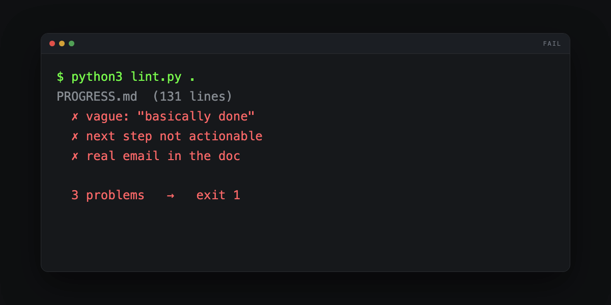

# progress-brief

**A handoff that reads the repo, not just the chat.**
Generates a converged `PROGRESS.md` for the next window, lints it, and tells you when to
restart the conversation instead of pushing on.

[](https://github.com/ming-coal/progress-brief/actions/workflows/test.yml)



## Install

One command, 90+ agents (it is a normal `SKILL.md` repo, so the standard CLI finds it):

```bash
npx skills add ming-coal/progress-brief
```

No Node? Use the scripts directly:

```bash
git clone https://github.com/ming-coal/progress-brief
python3 progress-brief/scripts/install.py
```

| your tool | how it gets wired |
|---|---|
| **OpenCode · Claude Code · Cursor · Codex · Gemini CLI · Windsurf · Cline · Copilot** | `npx skills add ming-coal/progress-brief` (add `-g` for user-level, `--agent claude-code` to target one) |
| **anything without the CLI** | `python3 install.py --target opencode  (or claude)`, or `--dest <dir>` for any folder |
| **agents that only read a rules file** | `python3 install.py --agents-md AGENTS.md` (also `GEMINI.md`, `.cursor/rules/...`) |
| **chat UIs** | `python3 install.py --prompt` prints a paste-ready block |

`--agents-md` is idempotent: re-running replaces its block and leaves the rest of the file alone.

### Or just tell your agent

> install the skill `ming-coal/progress-brief`, then use it on this project

That is enough for any agent that can run a shell: the repo resolves from GitHub, and the
`SKILL.md` at the root is the whole definition.

Skills are loaded when the agent starts, so **restart the session** after installing —
then ask for a progress brief and it should pick this up.

Then just say: *"this project is half done — give me a progress brief for the next window."*

---

## Why this one

There are already handoff skills (see [Related work](#related-work)). They mine the
conversation. This one **looks at the repository** and does three things a prompt can't:

| | A prompt / a chat summary | This |
|---|---|---|
| **Knows when not to bother** | always writes one | refuses under 15 files — measured: writing costs more than reading |
| **Enforces its own rules** | rules are suggestions | `lint.py` fails on vague wording, missing sections, unactionable steps, leaked keys and real emails (`example.com` passes, so examples still work) |
| **Proves the saving** | you guess | token ledger per run and cumulative, calibrated against a real tokenizer |
| **Detects a stale doc** | nobody checks | compares doc mtime with real edits, exit code 1 |
| **Says restart** | out of scope | the only part a document can't do |

Writing the document is the cheap part. **Deciding "this conversation is already rotten,
stop" is the part people get wrong.**

## Use it like a person

| You want | Say |
|---|---|
| first time | "this project is half done, give me a progress brief" |
| refresh | "update the progress doc" |
| next window | "read the progress doc and continue from step 2" |
| not sure whether to restart | "should I start a new window for this?" |
| a card to post | "make me a status card" |
| did it pay off | "how many tokens did this save?" |

You never name a file or a script. It picks what to read.

## What you get

A ~50 line project digest (not your source code):

```
files: 226  size: 2.6MB
## top level / changed in 7d / progress docs / todos / git / scripts
## token ledger
  worst    read every text file     210 files  ~289k tok
  typical  docs + 20 largest files   22 files   ~66k tok
  brief    scan output + PROGRESS.md             ~843 tok
  => 99% less than typical
```

A `PROGRESS.md` under 120 lines ([example](examples/PROGRESS.md)), a lint pass over it,
and optionally a 1080×1350 card ([example](examples/status.json)).

## Measured

Calibrated against `tiktoken` (cl100k) on a 263-file corpus of real code, English and
Chinese docs: **median error 6.8%, p90 14.5%**, plus a separate correction for the tool's
own tabular output (0.4% off in the check below). Install `tiktoken` and the numbers
become exact; without it the output says it is estimating.

| repo | text files | read everything | typical pickup | this tool | verdict |
|---|---|---|---|---|---|
| real Next.js app | 210 | 289k | 66k | **843** | 99% saved |
| sandbox fixture | 31 | 2k | 1k | 1k | 13% saved |
| 2-file folder | 2 | 3 | 3 | 243 | **refuses** |

Small projects get told to skip it. That is the feature, and `tests/test_tiers.py`
reproduces all three rows in CI so the table cannot drift from the code.

## In CI, not just in chat

```bash
python scripts/doctor.py . --json     # exit 1 = doc is stale, fail the job
python scripts/lint.py   . --json     # exit 1 = doc breaks the rules
python scripts/scan.py   . --json     # machine-readable metrics
```

A prompt can't fail a build. This can.

## When it pays off

- a project runs across days, windows, or models
- the conversation gets long and starts contradicting itself
- right after a merge / release / export — a natural break
- taking over someone else's repo
- a series (one directory per episode, one brief each)

**Not for**: one-off scripts, unstarted projects, folders under ~15 text files — it says so.

## Related work

| project | what it does | how this differs |
|---|---|---|
| [mattpocock/skills · handoff](https://github.com/mattpocock/skills) | compacts the conversation into a handoff doc | reads the repo, refuses when pointless, lints the result |
| [REMvisual/claude-handoff](https://github.com/REMvisual/claude-handoff) | chain-linked handoffs across sessions | not a chain; one converged doc per project |
| `session-handoff` topic | track half-done work across agents | same goal, adds the token ledger and the restart verdict |

If all you want is "summarize this chat into a file", those are lighter. The point here is
the repo side: what actually changed, what's stale, and whether the window is worth keeping.

## Files

| file | what |
|---|---|
| `SKILL.md` | instructions for the agent (rules, template, hygiene signals) |
| `scripts/scan.py` | project digest + token ledger (`--json`, `--no-ledger`) |
| `scripts/doctor.py` | continue / update / restart (`--json`, exit 0/1/2) |
| `scripts/lint.py` | rule check on the doc (`--rules` to list them, `--json`, `--strict`) |
| `scripts/card.py` | JSON → HTML + PNG (auto-finds Chrome/Chromium/Edge) |
| `scripts/calibrate.py` | re-fit the token estimate against `tiktoken` |
| `scripts/install.py` | installer (`--target`, `--dest`, `--agents-md`, `--prompt`) |
| `tests/` | 55 stdlib tests, CI on 3 OS × 2 Python versions |

## Honest limits

- Without `tiktoken` the token count is an estimate; the ledger counts runs, not handoffs.
- `doctor.py` reads the project, not your context window. The "should I compact" signals are rules, not a sensor.
- `lint.py` checks form, not truth. It cannot tell that a `✅` is a lie.
- Chinese docs: [README.zh-CN.md](README.zh-CN.md).

MIT licensed. See [CHANGELOG.md](CHANGELOG.md) and [CONTRIBUTING.md](CONTRIBUTING.md).
