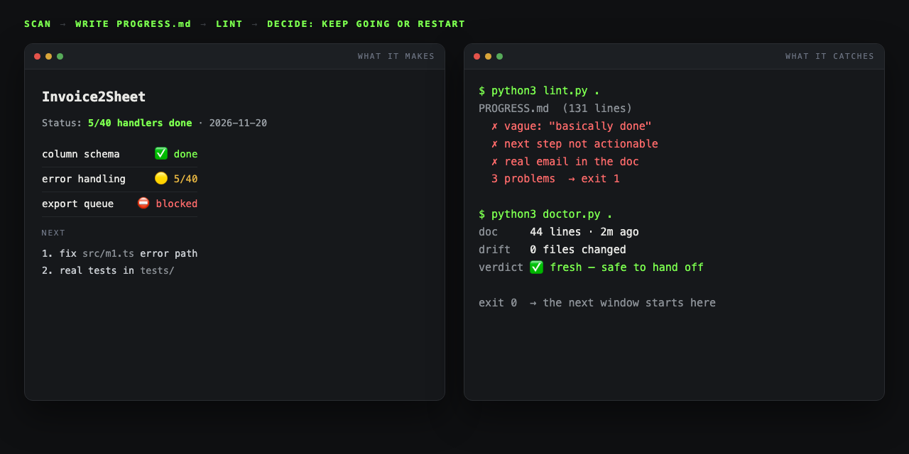

# progress-brief

**读仓库的交接工具，而不只是读聊天记录。**
为下一个窗口生成一份收敛的 `PROGRESS.md`，顺手体检它，并判断这轮对话该继续还是该重开。

[](https://github.com/ming-coal/progress-brief/actions/workflows/test.yml)



## 安装

一条命令，90+ 个 agent 都认（本质就是个带 `SKILL.md` 的仓库）：

```bash
npx skills add ming-coal/progress-brief
```

没有 Node 就直接用脚本：

```bash
git clone https://github.com/ming-coal/progress-brief
python3 progress-brief/scripts/install.py
```

| 你的工具 | 接入方式 |
|---|---|
| **OpenCode · Claude Code · Cursor · Codex · Gemini CLI · Windsurf · Cline · Copilot** | `npx skills add ming-coal/progress-brief`（`-g` 装到用户级，`--agent claude-code` 只装一个） |
| **没有这个 CLI** | `python3 install.py --target opencode  (or claude)`，或 `--dest <任意目录>` |
| **只读规则文件的 agent** | `python3 install.py --agents-md AGENTS.md`（也可 `GEMINI.md`、`.cursor/rules/...`） |
| **聊天界面** | `python3 install.py --prompt` 打印一段可粘贴的规则 |

`--agents-md` 是幂等的：重跑只替换那一段，文件其他地方不动。

### 或者直接跟 agent 说

> 安装 skill `ming-coal/progress-brief`，然后在这个项目上用

只要它能跑 shell 就够：仓库能从 GitHub 解析，根目录的 `SKILL.md` 就是全部定义。

然后直接说：「这个项目做到一半了，帮我整理个进度，我下次换窗口接着做」。

---

## 为什么用它

交接类的技能已经有不少（见[同类项目](#同类项目)），它们基本都在**总结对话**。
这个去看**仓库本身**，做三件提示词做不到的事：

| | 提示词 / 聊天总结 | 这个 |
|---|---|---|
| **知道什么时候不该写** | 无论如何都写 | 少于 15 个文件会拒绝——实测写了比直接读还贵 |
| **自己守规则** | 规则只是建议 | `lint.py` 对模糊表述、缺小节、不可执行的下一步、泄露的密钥直接判失败 |
| **能证明省了多少** | 靠猜 | token 账本，单次和累计，用真 tokenizer 校准过 |
| **能发现文档过期了** | 没人检查 | 比对文档时间和真实改动，退出码 1 |
| **会告诉你该重开** | 不管 | 只有它能做 |

写文档是便宜的部分，**判断“这轮对话已经废了、别硬撑”**才是大家一直做错的。

## 用：说人话

| 你想干的事 | 直接说 |
|---|---|
| 第一次整理 | 「这个项目做到一半了，帮我整理个进度」 |
| 更新 | 「进度更新一下」 |
| 换窗口接手 | 「读一下进度文档，接着往下做」 |
| 不知道要不要重开 | 「我这轮是不是该开个新窗口了」 |
| 要一张能发出去的图 | 「出一张进度卡片」 |
| 想知道值不值 | 「这省了多少 token」 |

不用告诉它看哪个文件、跑哪个脚本。

## 会看到什么

```
files: 226  size: 2.6MB
## top level / changed in 7d / progress docs / todos / git / scripts
## token 账本
  最坏  通读全部文本   210 文件  ≈ 289k tok
  典型  文档+20 个源文件 22 文件  ≈ 66k tok
  brief 这次只花                ≈ 843 tok
```

一份 ≤120 行的 [PROGRESS.md 示例](examples/PROGRESS.md)、一次 lint 检查，
以及可选的 [1080×1350 卡片](examples/status.json)。

## 数字是真的

用 `tiktoken`（cl100k）在 263 个真实文件上拟合，覆盖代码、英文文档、中文文档：
**中位误差 6.8%，p90 14.5%**；对工具自己生成的表格文本另做修正（实测偏差 0.4%）。

| 仓库 | 文本文件 | 通读全部 | 典型接手 | 本方案 | 结论 |
|---|---|---|---|---|---|
| 真实 Next.js 项目 | 210 | 289k | 66k | **843** | 省 99% |
| 测试沙盒 | 31 | 2k | 1k | 1k | 省 13% |
| 2 个文件的目录 | 2 | 3 | 3 | 243 | **劝你别用** |

小项目会被劝退，这是功能。`tests/test_tiers.py` 在 CI 里复现这三行，表格和代码不会对不上。

## 能进 CI

```bash
python scripts/doctor.py . --json     # 退出码 1 = 文档过期，让构建挂掉
python scripts/lint.py   . --json     # 退出码 1 = 文档不合规
python scripts/scan.py   . --json     # 机器可读指标
```

## 什么时候值得用

- 项目跨天、跨窗口、跨模型
- 对话变长了，开始自相矛盾、记错前面说过的事
- 一次合并 / 发布 / 成片之后，天然断点
- 接手别人的仓库
- 系列内容（一期一个目录，每期一份）

**别用**：一次性脚本、还没开始的项目、十来个文件的小目录——它会自己说。

## 同类项目

| 项目 | 做什么 | 差别 |
|---|---|---|
| [mattpocock/skills · handoff](https://github.com/mattpocock/skills) | 把对话压缩成交接文档 | 这个读仓库、会拒绝、会体检 |
| [REMvisual/claude-handoff](https://github.com/REMvisual/claude-handoff) | 多次会话链式交接 | 不做链，一个项目一份收敛的文档 |
| `session-handoff` 话题下的项目 | 跨 agent 追踪半成品 | 目标相同，多了 token 账本和“该重开”的判定 |

只想要“把这段聊天存成文件”，上面那些更轻。这里的重点在仓库一侧：
**到底改了什么、哪些说明过期了、这个窗口还值不值得留着。**

## 文件

| 文件 | 作用 |
|---|---|
| `SKILL.md` | 给 agent 的规则（写作规范、窗口卫生信号） |
| `scripts/scan.py` | 项目画像 + token 账本（`--json`、`--no-ledger`） |
| `scripts/doctor.py` | 继续 / 更新 / 重开（`--json`，退出码 0/1/2） |
| `scripts/lint.py` | 文档体检（`--json`、`--strict`） |
| `scripts/card.py` | JSON → HTML + PNG（自动找 Chrome/Chromium/Edge） |
| `scripts/calibrate.py` | 用 `tiktoken` 重新拟合估算系数 |
| `scripts/install.py` | 安装（`--target`、`--dest`、`--agents-md`、`--prompt`） |
| `tests/` | 55 个标准库测试，CI 覆盖 3 系统 × 2 个 Python 版本 |

## 诚实的边界

- 没装 `tiktoken` 时 token 是估算；账本记的是“运行次数”，不是“交接次数”。
- `doctor.py` 读的是项目，不是你当前上下文。窗口卫生那几条是规则，不是传感器。
- `lint.py` 查形式，不查真假。它看不出某个 ✅ 是撒谎。

MIT 协议。另有 [CHANGELOG](CHANGELOG.md) 和 [CONTRIBUTING](CONTRIBUTING.md)。
